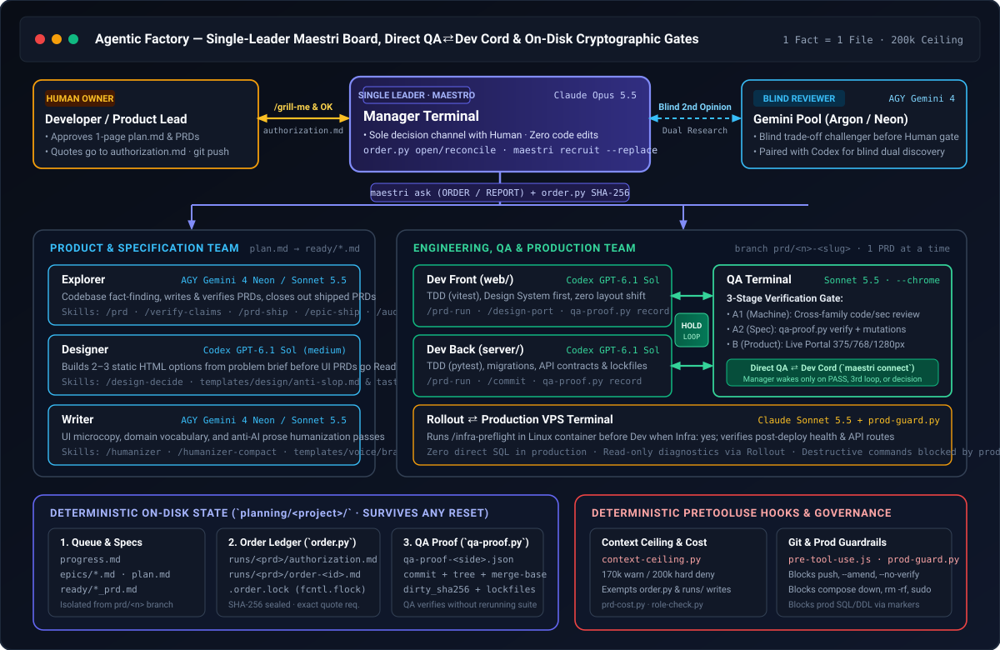
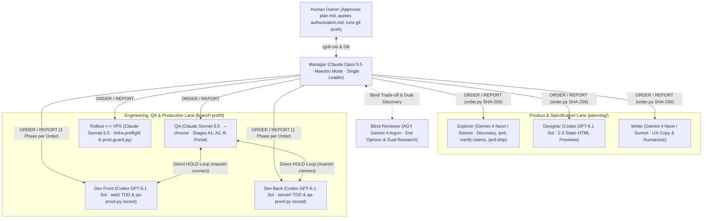
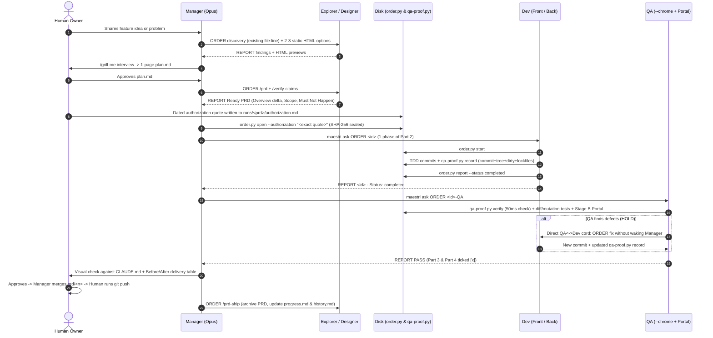
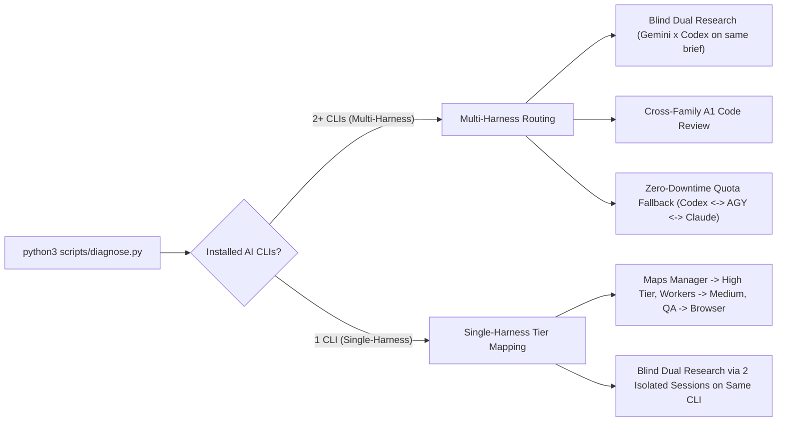

# Agentic Factory

> A provider-agnostic multi-agent software engineering harness powered by **Maestri**, deterministic on-disk state (`planning/`), SHA-256 execution and QA gates (`scripts/`, `hooks/`), and 23 portable skills. Extracted from the production setup behind **SeuTrampo AI**.



---

## 1. What This Is (and Why Prompt Collections Fail)

Most multi-agent repositories on GitHub give you a folder of markdown system prompts: a "Product Manager," an "Architect," a "Developer," and a "QA Engineer." They work for three turns on a toy todo app. Then you try to ship a real product with them and the whole thing falls apart.

I know because I built **SeuTrampo AI** (a full-stack job matching platform with React/TypeScript, Python/FastAPI, PostgreSQL, and Docker) running a multi-agent board every day across 230+ PRDs. When you rely on prompts alone, four things happen fast:

1. **Agents start coding while you are still brainstorming.** You answer a planning question and the leader dispatches three worker terminals before you even agree on the scope (`cases.md`, 2026-11-04).
2. **Context windows quietly explode.** A worker terminal runs six tasks in a row without resetting, hits **960,000 tokens**, and burns your entire 5-hour quota window in one sitting (2026-10-11).
3. **"Verified" means nothing.** A developer agent claims the test suite passed, or hashes `git diff HEAD` on a clean tree (which always produces the SHA-256 of an empty string, regardless of which commit is checked out), and QA rubber-stamps a stale build (`#209`).
4. **Prompts rot.** Every time an agent makes a mistake, you add another paragraph to `CLAUDE.md`. Within a month your prompt is 4,000 words long, cache-read costs double, and the model ignores half your instructions.

This repository is the fix I built for my own factory floor. It pairs **Maestri** (a visual canvas and terminal orchestrator that connects AI CLI sessions via cords, browser portals, and scheduled routines) with three hard engineering constraints:

- **One Fact = One File on Disk (`planning/<project>/`):** Memory never lives inside a chat thread. Plans (`plan.md`), executable specs (`ready/*_prd.md`), human dispatch authorizations (`runs/<prd>/authorization.md`), sealed work orders (`runs/<prd>/order-<id>.md`), and test proofs (`runs/<prd>/qa-proof-<side>.json`) live on disk and survive any context reset.
- **Cryptographic & Hook Guardrails (`scripts/` + `hooks/`):** Agents cannot dispatch work without an exact human authorization quote (`order.py`). QA verifies a SHA-256 proof tied to the exact git commit, tree, dirty state, and dependency lockfiles (`qa-proof.py`). PreToolUse hooks (`context-ceiling.py`, `pre-tool-use.js`, `prod-guard.py`) hard-block runaway sessions at 200k tokens, block `git push` and `--no-verify`, and block direct SQL against production.
- **Kaizen with Hard Word Budgets (`/canvas-retro`):** `board/core.md` is capped at **500 words** and every role prompt is capped at **400 words** (`compile-board.py --check-budgets`). To add a new rule during a retrospective, you must delete or merge an old one (`line balance <= 0`). Long war stories go into `cases.md`, keeping worker prompts sharp.

---

## 2. Visual Architecture & Workflow

For a self-contained interactive view where you can click every terminal node, inspect the 6-stage PRD state machine, and toggle between Multi-Harness and Single-Harness routing modes, open [**`docs/architecture.html`**](./docs/architecture.html) directly in any browser (works offline, zero dependencies).

### 2.1 Board Topology & Direct `QA ⇄ Dev` Cord

One **Manager** terminal leads the board. There is no middleman Orchestrator, Planner, or Scribe. Notably, `QA` is wired directly to `Dev Front` and `Dev Back` so `HOLD` fix loops resolve without waking the Manager.



### 2.2 PRD Lifecycle & Cryptographic Proof Sequence

Every non-trivial feature moves through six deterministic gates on disk. (A 1–2 file bug with zero product decisions takes the fast path: direct `ORDER` to `Dev` + end-to-end `QA`, skipping `plan.md` and `/prd`.)



### 2.3 Adaptive Multi-Harness Routing & Quota Fallback

Whether you subscribe to three AI providers (`claude`, `codex`, `agy`) or only one, `diagnose.py` and `compile-board.py` adapt the board automatically. Quota exhaustion never stops a sprint.



---

## 3. Core Strengths of the Setup

1. **Single-Leader Board + Direct `QA ⇄ Dev` Cord:** The Manager is the sole terminal that talks to you and the sole terminal that dispatches phases. Once a phase enters QA, `QA` and `Dev` resolve `HOLD` findings directly over their dedicated Maestri cord. The Manager only wakes up on `PASS`, when a product decision is required, on a 3rd failed round, or at the context ceiling.
2. **Cryptographic Order Ledger (`scripts/order.py`):** Work orders are not ephemeral chat messages. `order.py` writes `runs/<prd>/order-<id>.md` sealed with a SHA-256 digest and locked via `fcntl.flock`. It refuses to open an order unless `--authorization` matches a verbatim quoted string (`>= 15` characters) from `runs/<prd>/authorization.md`. After any terminal reset, `order.py reconcile --prd <n>` detects uncommitted work, missing reports, or recorded external effects (`commit`, `deploy`, `migration`) so nothing is ever executed twice.
3. **Git-Bound QA Proofs (`scripts/qa-proof.py`):** When `Dev` finishes Part 3, it runs the test suite through `qa-proof.py record`, producing a signed JSON proof bound to `commit`, `tree`, `merge-base`, `dirty_sha256` (`null` when clean, avoiding empty-diff hash collisions), the test command, and the git blob hashes of tracked lockfiles (`package-lock.json`, `uv.lock`, `Dockerfile`, etc.). In Stage A2, `QA` runs `qa-proof.py verify` in milliseconds instead of re-running the entire test suite, and focuses on diff tests, mutation tests, and live browser inspection.
4. **Hard 200k Token Ceiling (`hooks/context-ceiling.py`) & Cost Attribution (`scripts/prd-cost.py`):** `context-ceiling.py` reads the tail of the active session's JSONL transcript before every tool call, warning once at 170k tokens and blocking at 200k tokens while exempting `order.py report` and `runs/` writes so an agent can always save its state before resetting. `prd-cost.py` parses Claude and Codex transcripts to report exact token usage, API-equivalent USD cost, retry counts, and human interruptions per PRD.
5. **3-Layer Prompt Drift Detection (`scripts/role-check.py`):** Verifies that your modular markdown source (`board/*.md`), the active Maestri role (`role.json`), and project instructions (`CLAUDE.md` / `AGENTS.md`) are in sync and within word budgets.

---

## 4. Installing Maestri & Quickstart

### Prerequisites

1. **Install Maestri:** Download and install the **Maestri** desktop application and ensure the `maestri` CLI is available in your `PATH` (`maestri --version`). Maestri provides the visual terminal canvas, inter-agent cords (`maestri connect`, `maestri ask`), live browser portals (`maestri portal`), and scheduled one-shot routines (`maestri routine`).
2. **Install at least one AI coding CLI:**
   - **Claude Code** (`claude`)
   - **OpenAI Codex CLI** (`codex`)
   - **Google Antigravity CLI** (`agy`)
3. **Python 3.12+** (all governance scripts use the Python standard library only; zero `pip install` required) and **Node.js 18+** (for `hooks/pre-tool-use.js`).

### Step 1: Clone Agentic Factory & Run `diagnose.py`

Clone this repository and run the zero-token environment inspector against your target project:

```bash
git clone https://github.com/techlino/agentic-factory.git
cd agentic-factory

# Inspect installed AI CLIs, git topology, lockfiles, and recommended routing mode:
python3 scripts/diagnose.py --repo /path/to/your-project
```

`diagnose.py` outputs a clean JSON report showing which AI CLIs are installed (`maestri`, `claude`, `codex`, `agy`), whether your project is a monorepo (`web/` + `server/`) or single-package repo, which lockfiles exist for `qa-proof.py`, and whether to use `multi-harness` or `single-harness` routing.

### Step 2: Choose Your Directory Topology (Preventing `planning/` Divergence)

Because `Dev` terminals switch branches (`git switch -c prd/<n>-<slug>`) and reset worktrees during execution, **mutable planning files (`progress.md`, `ready/`, `runs/`) must never live inside the same git branch that `Dev` checks out**. Otherwise, your queue and order ledger will diverge across feature branches.

`/init-board` and `compile-board.py` support two topologies:

| Topology | Layout on Disk | When to Use |
| --- | --- | --- |
| **A. Parent Workspace Mode (Recommended)** | `<WORKSPACE_ROOT>/`<br>`├── .maestri/board/`<br>`├── planning/<project>/`<br>`└── projects/<project>/` | Best when managing one or more projects inside a dedicated workspace folder. `planning/` has its own local git history completely independent of `projects/<project>/`. |
| **B. Single-Repo Mode (Sibling Planning)** | `<PARENT_DIR>/`<br>`├── <project>/` *(your git repo)*<br>`├── <project>-planning/` *(isolated)*<br>`└── .maestri/board/` | Best when pointing at an existing standalone repository. `compile-board.py` places `planning/` in an isolated sibling directory (or dedicated git worktree) so switching to `prd/<n>` never touches `progress.md` or `runs/`. |

### Step 3: Run `/init-board` (or `compile-board.py`)

Open Claude Code, Codex, or Antigravity in this repository and invoke `/init-board` (defined in [`skills/init-board/SKILL.md`](./skills/init-board/SKILL.md)), or compile directly from a config file:

```bash
# Copy and customize the canonical config schema:
cp board.config.example.json board.config.json

# Validate role prompt word budgets (core.md <= 500w, roles <= 400w):
python3 scripts/compile-board.py --check-budgets

# Compile board roles, scaffold planning/<project>/, and generate Maestri launch scripts:
python3 scripts/compile-board.py --config board.config.json
```

`/init-board` interviews you on four decisions:
1. **Topology:** Parent Workspace vs. Single-Repo mode.
2. **Active Roles:** Core 4 (`Manager`, `Explorer`, `Dev`, `QA`) plus optional conditional roles (`Dev Front` + `Dev Back` split, `Designer`, `Writer`, `Rollout` + `VPS`, `Blind Reviewer`).
3. **AI Routing:** Confirming the primary model and fallback for each active role based on `diagnose.py`.
4. **Conversation Language:** Your preferred chat language with the Manager (`"en"`, `"pt-BR"`, `"es"`, etc.), while keeping all filenames, scripts, and `ORDER`/`REPORT` protocol markers in deterministic English.

### Step 4: Launch the Maestri Board

1. Open **Maestri** and create a workspace for your project:
   ```bash
   maestri workspace create "my-project" --dir /path/to/your-project --group "Boards"
   ```
2. If you use **Antigravity (`agy`)**, pre-trust the Maestri role directories so terminals never hang on interactive `"Trust this folder?"` prompts:
   ```bash
   python3 scripts/agy-trust.py
   ```
3. Register the compiled roles and recruit the worker terminals using the generated script in `.maestri/board/` (or manually open the **Manager** terminal with **Maestro mode enabled** and let `/canvas-manager` recruit and wire the board, including `maestri connect "QA" "Dev Front"` and `maestri connect "QA" "Dev Back"`).

---

## 5. The 23 Included Skills, 8 Governance Scripts & 3 Hooks

### 5.1 Portable Skills (`skills/<name>/SKILL.md`)

Every skill is written in 100% English, free of hardcoded machine paths, and includes a `## Harness portability` mapping so it runs identically on Claude Code, Codex, and Antigravity.

| Category | Skill | Purpose |
| --- | --- | --- |
| **Onboarding (1)** | [`/init-board`](./skills/init-board/SKILL.md) | Runs `diagnose.py`, interviews user on topology/roles/models, writes `board.config.json`, runs `compile-board.py` |
| **Board Orchestration (3)** | [`/canvas-manager`](./skills/canvas-manager/SKILL.md) | Starts or resumes the Manager session, checks quotas, resets idle dirty terminals, reports status in 3 lines |
| | [`/canvas-retro`](./skills/canvas-retro/SKILL.md) | Closes Manager session, writes `<= 40`-line retro, runs Kaizen rule gate with net-zero line balance (`<= 0`) |
| | [`/canvas-sprint`](./skills/canvas-sprint/SKILL.md) | Plans and schedules autonomous multi-PRD execution queues with zero human interruptions mid-run |
| **PRD & Epic Lifecycle (7)** | [`/prd`](./skills/prd/SKILL.md) | Stage 1 of 3: researches codebase, interviews user, writes executable PRD in `planning/<project>/ready/` |
| | [`/prd-run`](./skills/prd-run/SKILL.md) | Stage 2 of 3: executes Part 2 phases with strict TDD and records Part 3 `qa-proof.py` |
| | [`/prd-ship`](./skills/prd-ship/SKILL.md) | Stage 3 of 3: runs A2 review (`references/review.md`), B QA (`references/qa.md`), and archival (`references/close-out.md`) |
| | [`/prd-demo`](./skills/prd-demo/SKILL.md) | Records Playwright visual evidence packages (`390px` & `1440px` screenshots, MP4, GIF) when `Demo: yes` |
| | [`/epic-ship`](./skills/epic-ship/SKILL.md) | Verifies epic rollup and quality gates, archives the epic, and cleans `progress.md` |
| | [`/commit`](./skills/commit/SKILL.md) | Splits pending changes into logical conventional commits in English without attribution trailers or `git push` |
| | [`/handover`](./skills/handover/SKILL.md) | Writes a self-contained session handover document when closing a long cycle |
| **Verification Gates (4)** | [`/verify-claims`](./skills/verify-claims/SKILL.md) | Proves every file path, line number, symbol, and command cited in a PRD or audit exists in git `HEAD` |
| | [`/verify-ui`](./skills/verify-ui/SKILL.md) | Verifies responsive layout and computed geometry across `375px`, `768px`, and `1280px+` breakpoints |
| | [`/infra-preflight`](./skills/infra-preflight/SKILL.md) | Pre-flight method and pitfall catalog for Docker, Compose, CI, cron, and migration PRDs (`Infra: yes`) |
| | [`/design-port`](./skills/design-port/SKILL.md) | 3-phase literal port of approved static HTML/design artifacts into production components with side-by-side gate |
| **Product & Critique (5)** | [`/grill-me`](./skills/grill-me/SKILL.md) | Relentless one-question-at-a-time interview that stress-tests an idea until every decision branch is locked |
| | [`/product-eval`](./skills/product-eval/SKILL.md) | Evaluates a live product as a user, anchors critiques to `file:line`, locks decisions, and builds an epic + PRD queue |
| | [`/audit-codebase`](./skills/audit-codebase/SKILL.md) | Technical health audit producing measured findings with `file:line` evidence and numeric trigger priority |
| | [`/design-decide`](./skills/design-decide/SKILL.md) | Chooses visual direction from 3 user references using `templates/design/anti-slop.md` kill rules |
| | [`/ui-ux-analysis`](./skills/ui-ux-analysis/SKILL.md) | Live WCAG 2.2 AA, design-token, mobile-first, and Core Web Vitals audit that auto-generates missing PRDs |
| **Writing & Signal (3)** | [`/concise-output`](./skills/concise-output/SKILL.md) | Enforces high signal density, direct answers first, and zero conversational filler |
| | [`/humanizer`](./skills/humanizer/SKILL.md) | Strips 29 Wikipedia-cataloged AI writing tells from long-form prose (>150 words) |
| | [`/humanizer-compact`](./skills/humanizer-compact/SKILL.md) | Fast anti-AI pass tuned for short UI microcopy, tooltips, error states, and form fields (<=150 words) |

### 5.2 Deterministic Scripts (`scripts/`) & Hooks (`hooks/`)

| Script / Hook | Language | Role in the Factory |
| --- | --- | --- |
| [`scripts/diagnose.py`](./scripts/diagnose.py) | Python 3 (stdlib) | Detects installed AI CLIs (`maestri`, `claude`, `codex`, `agy`), repo structure, worktrees, and lockfiles |
| [`scripts/compile-board.py`](./scripts/compile-board.py) | Python 3 (stdlib) | Enforces word budgets (`--check-budgets`), renders `board/*.md` + `board.config.json`, scaffolds `planning/`, installs skills |
| [`scripts/order.py`](./scripts/order.py) | Python 3 (stdlib) | SHA-256 `ORDER`/`REPORT` state machine (`open`, `start`, `report`, `check`, `reconcile`) with `authorization.md` quote check |
| [`scripts/qa-proof.py`](./scripts/qa-proof.py) | Python 3 (stdlib) | Cryptographic test execution proof (`record`, `verify`) bound to commit, tree, dirty hash, command, and lockfiles |
| [`scripts/role-check.py`](./scripts/role-check.py) | Python 3 (stdlib) | 3-layer prompt parity validator (`board/*.md` -> Maestri `role.json` -> `CLAUDE.md`/`AGENTS.md`) |
| [`scripts/prd-cost.py`](./scripts/prd-cost.py) | Python 3 (stdlib) | Parses `ORDER`/`REPORT` across Claude and Codex transcripts for token/USD attribution, retries, and QA rounds |
| [`scripts/agy-trust.py`](./scripts/agy-trust.py) | Python 3 (stdlib) | Pre-trusts Maestri role UUID folders in Antigravity so headless worker terminals never block on trust prompts |
| [`scripts/manager-context.sh`](./scripts/manager-context.sh) | POSIX Shell | Reports live context token consumption (in `k`-tokens) for any active session ID |
| [`hooks/pre-tool-use.js`](./hooks/pre-tool-use.js) | Node.js | Blocks `git push`, `--amend`, `--no-verify`, `core.hooksPath=`, `docker compose down`, `rm -rf`, `sudo`, and files >800 lines |
| [`hooks/context-ceiling.py`](./hooks/context-ceiling.py) | Python 3 (stdlib) | Warns at 170k tokens and hard-denies tools above 200k tokens, exempting `maestri`, `order.py`, and `runs/` writes |
| [`hooks/prod-guard.py`](./hooks/prod-guard.py) | Python 3 (stdlib) | Blocks direct SQL, DDL, or destructive commands targeting any host/domain/file listed in `production.markers` |

---

## 6. Recommended Ecosystem & Extensions

Agentic Factory handles orchestration, on-disk planning state, and verification gates. In daily production on SeuTrampo AI, I pair it with four external extensions that cover language-level coding standards and YAGNI discipline:

1. **[Everything Claude Code (`affaan-m/everything-claude-code`)](https://github.com/affaan-m/everything-claude-code)**
   - **Why install it:** Provides domain-specific engineering skills (`tdd-workflow`, `react-doctor`, `security-review`, `e2e-testing`, `api-design`, `backend-patterns`) and language reviewers that `Dev` and `QA` invoke during `/prd-run` and Stage A1 reviews.
2. **[Ponytail (`DietrichGebert/ponytail`)](https://github.com/DietrichGebert/ponytail)**
   - **Why install it:** LLMs love over-engineering: inventing abstract base classes for one caller, adding npm packages for a 5-line function, or wrapping standard library calls in 200 lines of ceremony. Loading `ponytail` (and `/ponytail-review`) on `Dev` terminals forces the simplest, shortest stdlib solution that passes the tests.
3. **[Anthropic Official Plugins (`anthropics/claude-plugins-official` & `anthropics/knowledge-work-plugins`)](https://github.com/anthropics/claude-plugins-official)**
   - **Why install it:** Official Claude Code plugin integrations and MCP harnesses (including Chrome DevTools MCP for the `QA` terminal's `--chrome` browser inspection).
4. **Local Git Hooks ([`templates/githooks/pre-commit`](./templates/githooks/pre-commit) & [`templates/githooks/pre-push`](./templates/githooks/pre-push))**
   - **Why install them:** Wire `git config core.hooksPath .githooks` inside your project repository so `pre-commit` enforces formatting/lint/typecheck on every `Dev` commit and `pre-push` runs the scoped test suite before your manual `git push` reaches remote CI. Because `hooks/pre-tool-use.js` blocks `--no-verify` and `-c core.hooksPath=`, agents cannot bypass them.

---

## 7. Production Case Study: SeuTrampo AI

Want to see how this harness behaves under real production pressure? Browse [**`docs/case-study-seutrampo/`**](./docs/case-study-seutrampo/README.md):

- [**Architecture Evolution & Token Discipline (`docs/case-study-seutrampo/README.md`)**](./docs/case-study-seutrampo/README.md): Why I killed the Orchestrator, Planner, and Scribe roles, how the 960k-token runaway session happened on October 11, 2026, and what 160 session transcripts revealed about context ceilings.
- [**The 12 November 2026 War Stories (`docs/case-study-seutrampo/cases.md`)**](./docs/case-study-seutrampo/cases.md): Every real failure (premature midnight sprint dispatch, ghost prompt autocomplete illusions, inverted test negations, wireframe grey bars shipped to prod, annotated test flakes breaking `git push`) paired with the rule or script that fixed it.
- [**Annotated Production PRD (`docs/case-study-seutrampo/sample-prd.md`)**](./docs/case-study-seutrampo/sample-prd.md): Full English translation of PRD `#230 (Search Summary Bar)`, including non-duplication `grep` proofs, Design System First staging, and 6 rounds of QA pixel measurements over the direct `QA ⇄ Dev` cord.
- [**Sample Kaizen Retrospective (`docs/case-study-seutrampo/sample-retro.md`)**](./docs/case-study-seutrampo/sample-retro.md): A real `/canvas-retro` closure demonstrating blind 3-way golden-set labeling (`60/79` unanimous, only `2/79` escalated to the human) and a net-zero line-balance diff on `board/manager.md`.

---

## Verification & Tests

Run the full verification suite from the repository root (Python 3.12+ standard library only):

```bash
# 1. Run all unit & integration tests (order.py, qa-proof.py, hooks, diagnose, compile, leak gate):
python3 -m unittest discover -s tests -p "test_*.py" -v

# 2. Run the zero-leak and portability gate across all docs, skills, scripts, and templates:
python3 -m unittest tests/test_leak_and_portability.py -v

# 3. Verify role prompt word budgets (core.md <= 500 words, role prompts <= 400 words):
python3 scripts/compile-board.py --check-budgets
```
